# Kotler AI

[](https://github.com/AdarshSingh113/StoickMind/actions/workflows/tests.yml)

**An AI CRM for Indian D2C brands that sells, supports and retains customers, built from scratch on free tiers (₹0).**

AI agents answer customers on WhatsApp, Telegram and a website chat in English, Hinglish and Hindi. They recommend
products from the real catalogue, track and cancel orders, raise refunds within limits enforced in code, and hand
over to a person when it matters. Machine learning scores every customer (churn, lifetime value, COD refusal risk);
retention campaigns are A/B tested against a holdout; a listening agent reads what people say about the brand and
the market on YouTube, Bluesky and in the news; every AI call is traced, measured and priced.

It runs on a simulated skincare brand, *Glow & Co.*: 1,500 customers, ~3,700 orders, 36 products.

> A learning and portfolio project inspired by AI commerce platforms such as BIK.ai. Not affiliated with any company.
> Demo data only: no real customers, payments or deliveries.

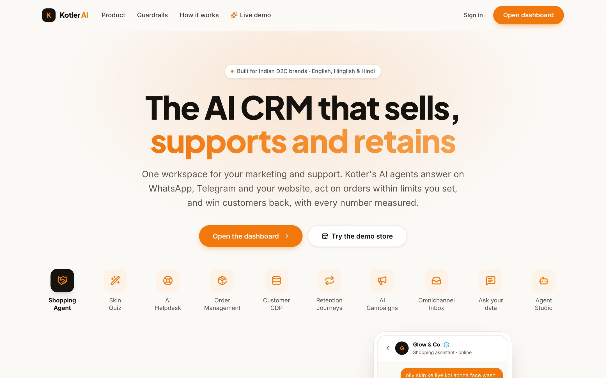

---

## Contents

[Screenshots](#screenshots) · [Features](#features) · [Architecture](#architecture) · [Guardrails](#guardrails-in-code-not-just-in-prompts) ·
[Results](#results-tested-against-a-real-model) · [Quick start](#quick-start) · [Configuration](#configuration) ·
[Channels](#channels-telegram-whatsapp-website) · [Tests and CI](#tests-and-ci) · [Project structure](#project-structure) ·
[Learning notes](#learning-notes) · [Honest notes](#honest-notes)

---

## Screenshots

All taken from the running app with real Gemini answers (nothing mocked).

| | |
|---|---|
| **Demo store + chat:** Hinglish question, product cards with Buy buttons<br>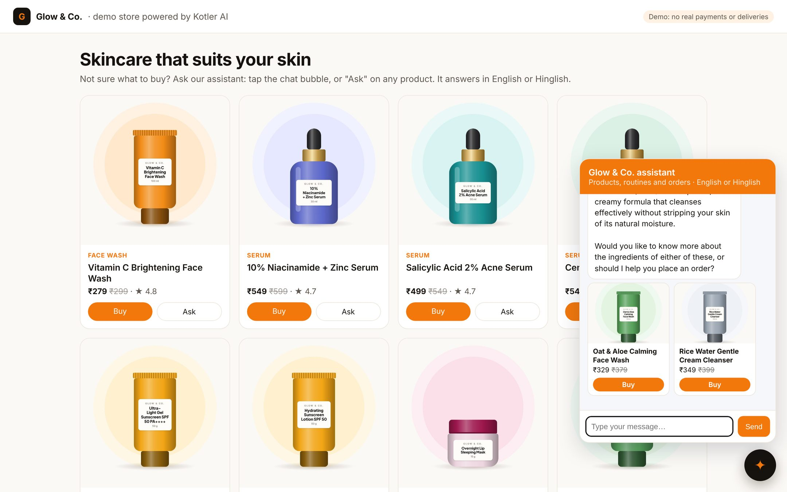 | **Overview:** revenue, insights, operations and sales from AI chats<br>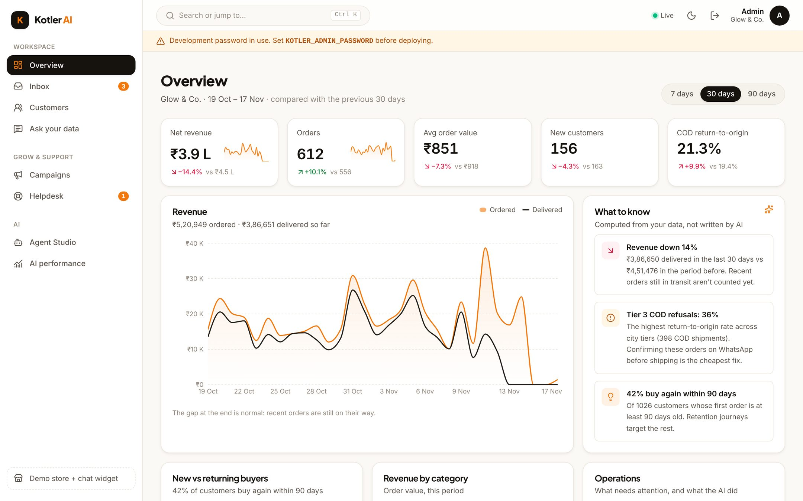 |
| **Inbox copilot:** AI summary, suggested reply grounded in real orders<br>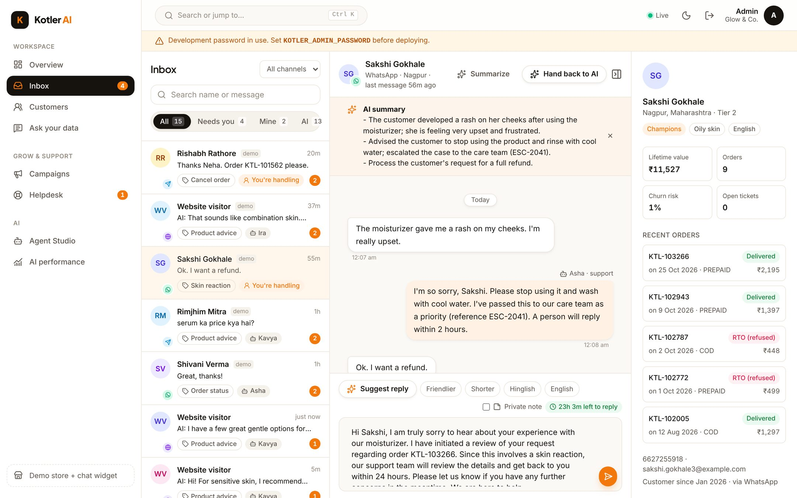 | **Customer 360:** ML scores, behaviour, "bought via AI chat"<br>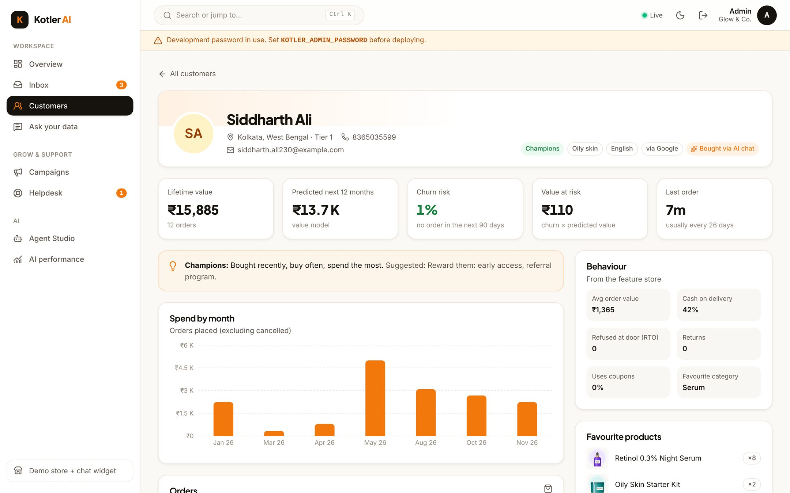 |
| **Campaign results:** A/B vs holdout, confidence ranges, honest verdict<br>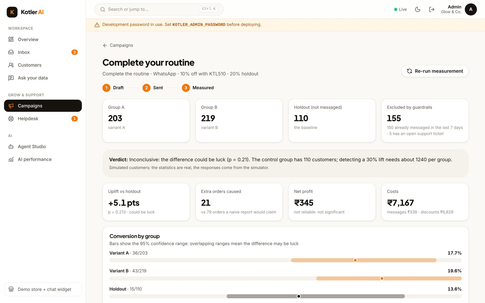 | **AI performance:** topics and share handled fully by AI<br>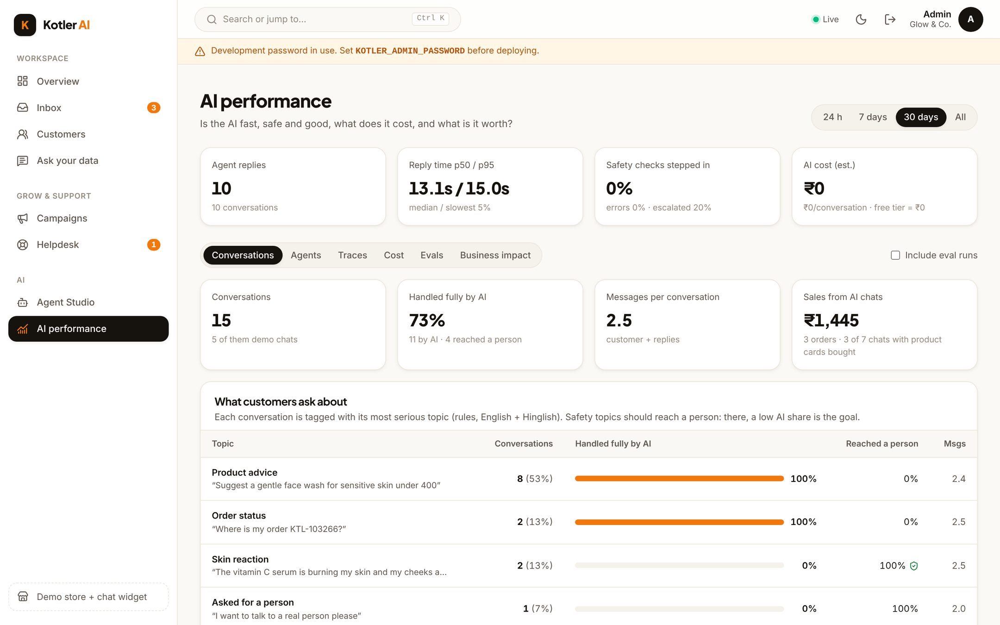 |
| **Agent Studio:** handoff rules and what the agent can see and change<br>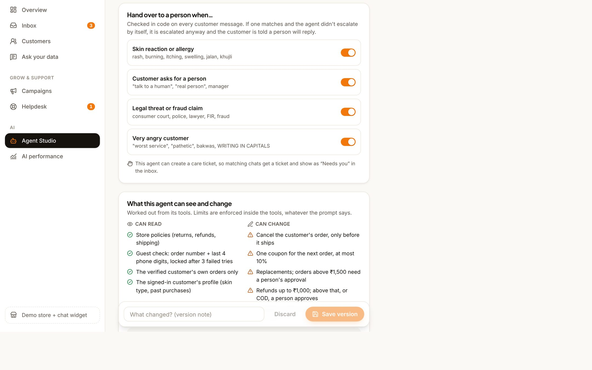 | **Ask your data:** plain English to checked SQL, chart and summary<br>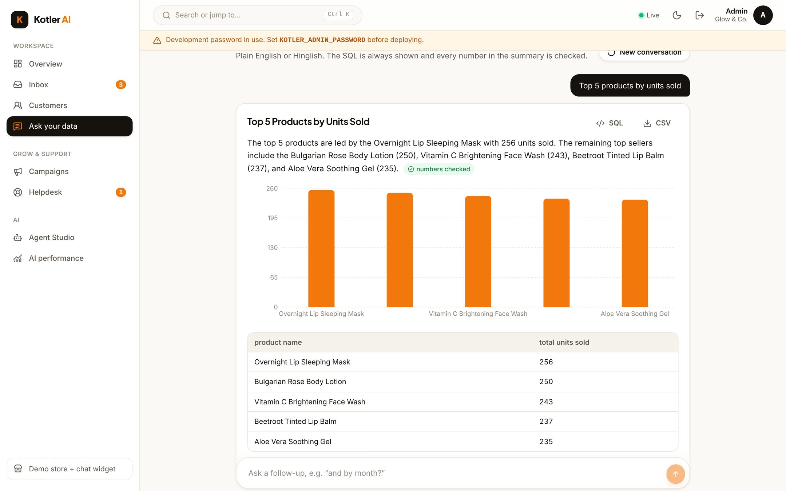 |
| **Social listening:** real Bluesky and news mentions, topics, ingredients with your products<br>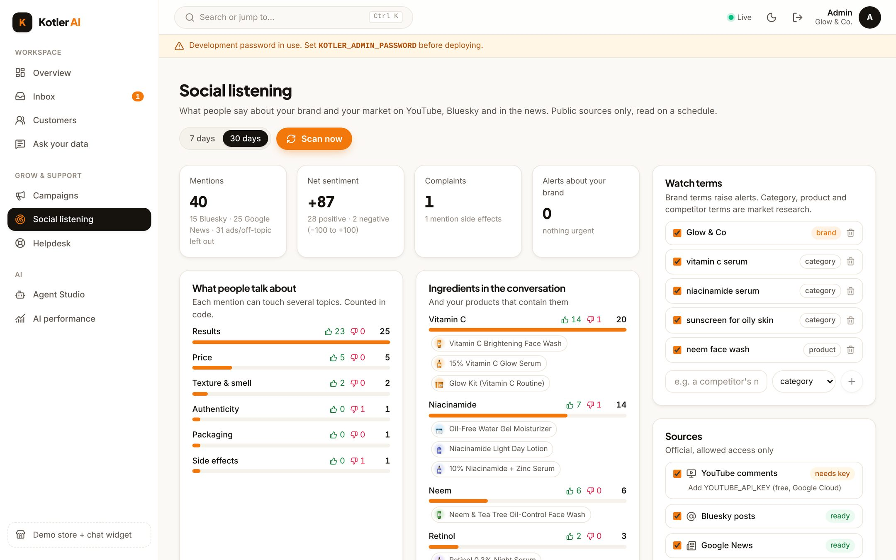 | **AI brief:** numbers checked against the counts, every [n] links to a real post<br>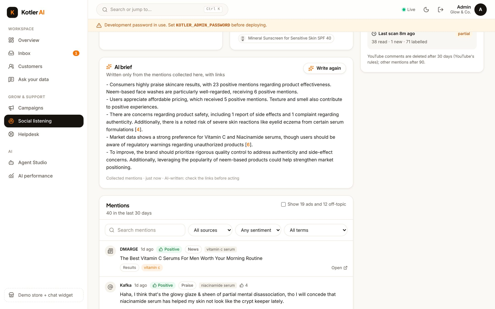 |

---

## Features

### Sell
- **Kavya, the shopping agent:** recommends from the real catalogue (search, compare, build a routine within a budget).
  Understands "500 ke andar" and "daane". Prices come only from tool results.
- **Ira, the skin quiz:** one question at a time, saves the skin profile, ends with an in-stock routine.
- **Product cards everywhere:** photo, price, rating and Buy button in the website chat, inbox, Telegram and WhatsApp.
  Shown only for products a tool returned and the reply names.
- **Demo store + one-line chat widget** (`<script src=".../widget.js">`), and a demo checkout.
- **Sales from AI chats:** Buy links are signed (HMAC), so orders are attributed to the conversation that made them,
  and can't be faked by editing a URL.

### Support
- **Asha, the helpdesk agent:** order status, guest verification (order number + last 4 phone digits), cancel-and-save,
  damaged items, refunds, store-policy search (BM25 retrieval), and escalation to a person.
- **Order actions with limits in code:** refunds up to ₹1,000 go through, bigger ones (and COD) wait for approval;
  coupons capped at 10%; cancel only before shipping.
- **Approvals queue and helpdesk copilot** for tickets.

### Inbox
- **Omnichannel live inbox:** Telegram, WhatsApp and website chats, live updates (Server-Sent Events), human takeover
  (the AI goes quiet until handed back), unread counts, Ctrl+K search.
- **AI copilot for the team:** suggest a reply, make it friendlier or shorter, translate to Hinglish or English,
  summarize the chat. Grounded in the chat, the customer's real orders and the policies; order numbers and ₹ amounts
  that aren't in that context are flagged before sending.
- **Private notes**, **topic tags** on every chat, and the WhatsApp 24-hour reply window.

### Know your customers
- **Customer 360:** orders, chats, tickets, campaigns, favourite products, behaviour.
- **ML:** RFM segments, churn risk and 12-month value (time-based validation), and a **COD refusal (RTO) predictor**
  with a threshold chosen in rupees.
- **Plain-English segment builder:** "customers who bought serum but never sunscreen" to guarded SQL.

### Retain
- **Four journeys:** replenishment, win-back, cross-sell, second order.
- **AI campaigns:** A/B messages in English and Hinglish written by the model, with placeholders for prices and codes
  (the model never types a price). Discount cap, 7-day frequency cap, opt-out, open-ticket exclusion.
- **Measured against a holdout:** uplift, 95% confidence ranges, significance, required sample size and ROI.
  Customer responses come from a simulator, and the page says so.

### Listen
- **Social listening agent:** on a schedule (or "Scan now"), reads public mentions of your watch terms from
  **YouTube** comments, **Bluesky** posts and **Google News**. Official access only; no scraping.
- **Brand and market:** brand terms raise alerts (a skin reaction or legal threat about you); category, product
  and competitor terms are market research ("what do people say about vitamin C serums?").
- **Signal, not noise:** ads, reposts and off-topic results are filtered out. On real data, about 1 in 4 Bluesky
  results were ads.
- **AI labels** (sentiment, kind, aspects, an English gist for any language), with comments treated as untrusted
  data. Ingredients are tagged in code and linked to your own products.
- **AI brief** with checked numbers and `[n]` links to the real posts. With a paid Gemini key it uses Google Search
  grounding instead.
- **Data rules:** YouTube comments are deleted after 30 days (YouTube's developer policies); other mentions after 90.

### Build agents
- **Agent Studio:** agents are configuration (instructions, goal, success criteria, tools, temperature). Every save is
  a version; restore in one click; playground; LLM judge scores conversations against the success criteria.
- **Handoff rules:** skin reaction, asks for a person, legal threat, very angry. Enforced in code, see below.
- **"What this agent can see and change":** derived from its tools, with the real limits.

### Measure
- **Tracing** of every LLM call, tool call and safety check (traces and spans, like Langfuse or OpenTelemetry).
- **AI performance:** conversations and topics, share handled fully by AI, per-agent speed / safety / quality / cost,
  trace waterfall, eval history with regression diffs, and **business impact in ₹**, each number tagged
  *measured*, *modelled*, *simulated* or *revenue* and never mixed.
- **Ask your data:** questions in plain English or Hinglish to read-only SQL, with personal columns blocked one by one,
  a validated chart and a summary whose every number is checked against the result.

---

## Architecture

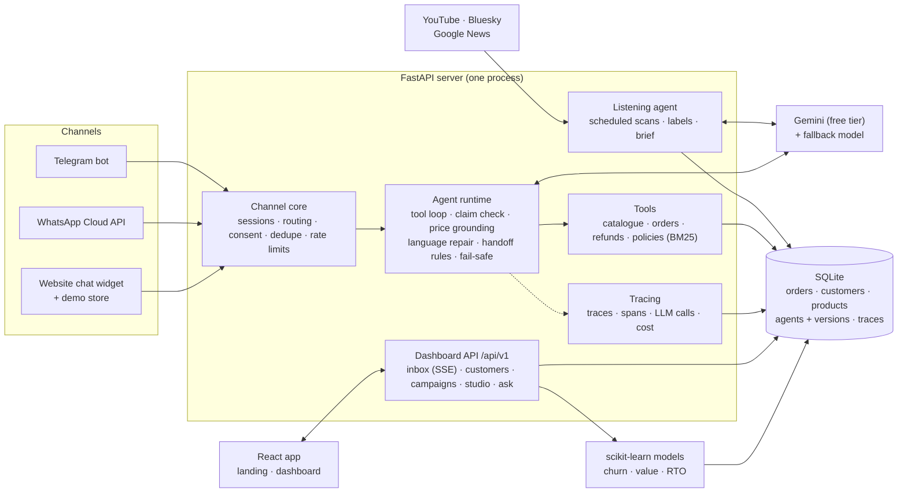

- **One agent runtime, many agents:** Kavya, Ira and Asha are rows in the `agents` table, not classes. The runtime
  composes the prompt, runs the tool loop and applies the guards to any of them.
- **Instrument at the choke point:** every LLM call goes through one `chat()` method, so tracing can't be forgotten.
- **One container:** the Dockerfile builds the React app and serves it from FastAPI (176 MB image, runs in 512 MB).

---

## Guardrails in code, not just in prompts

A prompt is a request. These are rules the model can't talk its way around, each covered by tests:

| Guardrail | What it does |
|---|---|
| **Claim check** | A reply that says "refund done" or "order cancelled" without the tool call that did it is sent back once; if it still claims it, a fail-safe escalates to a person instead. |
| **Price grounding** | A ₹ amount that no tool returned (and the customer didn't say) is blocked and corrected. |
| **Limits in tools** | Refund, replacement, discount and verification limits live in `kotler/policy.py` and are enforced inside the tools. |
| **Handoff rules** | Skin reaction, legal threat, "talk to a human", anger: a person is pulled in even if the model forgets. |
| **Language repair** | Hinglish in, Hinglish out: detected in code; an English reply is rewritten with every fact kept. |
| **Product cards** | Only products a tool returned this turn; prices from the database. |
| **Copilot fact flags** | Order numbers and ₹ amounts not in the chat or the customer's orders are flagged before a person sends them. |
| **Privacy** | Guests see no order data until verified (3 attempts); Ask your data blocks names, phones, emails, addresses and chat IDs column by column. |
| **Campaign safety** | Placeholders for prices and codes, discount cap, frequency cap, opt-out, holdout group. |
| **Signed attribution** | AI sales count only when the Buy link's HMAC signature is intact. |
| **Untrusted comments** | Public posts reach the model as data, labels must come from fixed lists, links are stripped: a prompt-injection comment can only mislabel itself. |

---

## Results: tested against a real model

Evaluation suites run the real agents on **Gemini** and check outcomes in the database, not just the wording:

| Suite | Result | What is checked |
|---|---|---|
| Shopping + skin quiz (`kotler.evals.shopping`) | **26 / 26** | right tools, prices grounded, in stock, within budget, suits the skin type, reply language, stays in scope |
| Helpdesk (`kotler.evals.helpdesk`) | **14 / 14** | order really cancelled / kept, refund raised only within policy, escalated when required, no data leak to other customers, coupon ≤ 10%, LLM-judged quality |
| Ask your data (`kotler.evals.ask_data`) | **12 / 12** | the SQL result matches the gold answer |

After the handoff rules were added, the affected cases were re-run on Gemini and still pass. Results are saved and
shown on **AI performance → Evals**, with diffs between runs.

---

## Quick start

You need Python 3.11+ and Node 20+.

```bash
git clone https://github.com/AdarshSingh113/StoickMind.git
cd StoickMind
python -m venv .venv
source .venv/bin/activate                    # Windows: .venv\Scripts\activate
pip install -r requirements.txt
cd frontend && npm install && npm run build && cd ..
uvicorn kotler.server:app --port 8000
```

Open http://localhost:8000. The demo database is created on first start.

- `/`: landing page
- `/app`: dashboard (local password: `kotler`)
- `/store`: demo store with the chat widget

AI features need a free Gemini key from [aistudio.google.com](https://aistudio.google.com): `export GEMINI_API_KEY=...`
before starting (or put it in `.streamlit/secrets.toml`, which is git-ignored). Without a key everything else works and
AI buttons explain what's missing.

**Developing the frontend** with hot reload: run the API as above, then `cd frontend && npm run dev`
(http://localhost:5173, proxied to the API).

**Docker:**

```bash
docker build -t kotler-ai .
docker run -p 8000:8000 -e KOTLER_ADMIN_PASSWORD=choose-one -e GEMINI_API_KEY=your-key kotler-ai
```

**GitHub Codespaces:** open the repo in a Codespace, add `GEMINI_API_KEY` (and `TELEGRAM_BOT_TOKEN`) as Codespaces
secrets, then run the commands above.

**Free hosting (Render):** see [docs/deploy.md](docs/deploy.md).

**Social listening from the command line:** `python -m kotler.listening scan` (one scan),
`python -m kotler.listening watch --every 6` (forever), `python -m kotler.listening brief`.

**Classic Streamlit dashboard** (the first version of the UI, still works): `streamlit run app.py`.

---

## Configuration

Secrets come from environment variables (or the git-ignored `.streamlit/secrets.toml`). Never commit them.

| Variable | Needed for |
|---|---|
| `GEMINI_API_KEY` | all AI features |
| `KOTLER_ADMIN_PASSWORD` | dashboard login; **required in production** (login is disabled without it) |
| `KOTLER_SECRET_KEY` | optional: signs login cookies and Buy links (default: derived from the password) |
| `PUBLIC_BASE_URL` | your public address: product photos on WhatsApp and Buy buttons on Telegram/WhatsApp |
| `TELEGRAM_BOT_TOKEN`, `TELEGRAM_WEBHOOK_SECRET` | Telegram bot (polling needs only the token) |
| `WHATSAPP_PHONE_NUMBER_ID`, `WHATSAPP_ACCESS_TOKEN`, `WHATSAPP_APP_SECRET`, `WHATSAPP_VERIFY_TOKEN` | WhatsApp Cloud API |
| `WHATSAPP_ALLOWED_NUMBERS` | comma-separated test numbers; nothing is ever sent to other numbers |
| `KOTLER_ALLOWED_ORIGINS` | sites allowed to embed the chat widget (default `*`) |
| `KOTLER_LLM_MODEL`, `KOTLER_LLM_FALLBACK_MODELS` | model choice (default `gemini-3.5-flash`, fallback `gemini-3.1-flash-lite`) |
| `KOTLER_LLM_PROVIDER`, `KOTLER_LLM_BASE_URL`, `KOTLER_LLM_API_KEY` | optional: any OpenAI-compatible provider (Groq, Ollama, ...) |
| `YOUTUBE_API_KEY` | social listening on YouTube: a free key from Google Cloud with **YouTube Data API v3** enabled (Bluesky and Google News need no key) |
| `KOTLER_LISTENING_SCHEDULER` | `off` stops the server's listening schedule (it only scans when "every N hours" is set on the page) |
| `KOTLER_DB_PATH` | where the SQLite file lives (default `data/kotler.db`) |

---

## Channels: Telegram, WhatsApp, website

```bash
python -m kotler.channels.telegram poll      # Telegram bot, no public URL needed
```

- **Telegram:** create a bot with @BotFather, set `TELEGRAM_BOT_TOKEN`, run the command above. Commands: `/shop`,
  `/help`, `/quiz`, `/new`; `STOP` opts out of marketing messages.
- **Website:** add `<script src="https://your-server/widget.js" defer></script>` to any page.
- **WhatsApp:** Meta Cloud API test number, signed webhooks, the 24-hour window and an allowlist of test numbers.
  Step by step in [docs/deploy.md](docs/deploy.md).

All three share one core: the same agents, sessions, consent (STOP), deduplication and rate limits, and all of them
appear in the same inbox.

---

## Tests and CI

```bash
pytest                                        # 386 tests
cd frontend && npm run typecheck && npx vitest run && npm run build
# 44 end-to-end checks in a real browser, against a running server (needs: npm i -g playwright && npx playwright install chromium)
NODE_PATH=$(npm root -g) node frontend/e2e/smoke.mjs http://localhost:8000
GEMINI_API_KEY=... python -m kotler.evals.shopping   # real-model evals (also: helpdesk, ask_data)
```

GitHub Actions runs on every push:

- **pytest** on Python 3.11 and 3.13
- **frontend:** typecheck, unit tests and build
- **e2e:** the Playwright smoke test against a fresh database
- **docker:** builds the image, runs it with 512 MB of memory, checks the pages, the login and that a production
  container refuses the development password

Tests never call a real model: a scripted `FakeLLM` stands in, so they are fast, free and repeatable.

---

## Project structure

```
kotler/
  agent/          agent runtime, Agent Studio store, tools, guards (claims, prices, language), handoff rules,
                  topic classifier, product cards, team copilot, judge, policy retrieval
  channels/       Telegram / WhatsApp / web adapters around one core (sessions, routing, consent, dedupe)
  api/            dashboard API: auth, overview, inbox (SSE), customers, ask + performance, campaigns + helpdesk, studio
  analytics/      Ask your data: guarded text-to-SQL, chart validation, number-checked summaries
  marketing/      journeys, campaign engine, customer simulator, experiment statistics
  ml/             feature store, RFM segments, churn / value / RTO models, segment builder, training pipeline
  obs/            tracing, metrics and cost, conversation analytics, eval history, business impact
  evals/          real-model evaluation suites
  listening/      social listening: watch terms, YouTube / Bluesky / Google News sources, labels, insights, schedule
  seed/           catalogue, data generator with planted patterns, product image catalogue
  web/            chat widget, demo store, checkout, product images (media/)
  store.py        demo checkout and signed AI attribution
  server.py       FastAPI app: webhooks, chat API, store, serves the React app
  policy.py       store policies: limits enforced in code + the text agents retrieve
  llm.py          Gemini / OpenAI-compatible client with fallback, and FakeLLM for tests
frontend/         React 19 + TypeScript + Vite + Tailwind; e2e/ smoke test
scripts/          product image renderer
tests/            pytest suite
docs/             learning notes, deployment guide, screenshots
Dockerfile        one image: builds the React app, serves everything from Python
views/, app.py    classic Streamlit dashboard
```

### Tech stack (all free)

| | |
|---|---|
| Backend | Python, FastAPI, SQLite (plain SQL, no ORM), pandas |
| AI | Gemini API (free tier) via REST, with a fallback model; any OpenAI-compatible provider optional |
| ML | scikit-learn (logistic regression, gradient boosting) |
| Retrieval | BM25 over the store policies (small corpus: no vector database needed) |
| Frontend | React 19, TypeScript, Vite, Tailwind CSS v4, TanStack Query, Recharts, cmdk |
| Quality | pytest, Vitest, Playwright, GitHub Actions |
| Ship | Docker, Render free tier |

---

## Learning notes

Every phase has a write-up explaining *what* was built, *why* it was built that way and *how* it works:

1. [Database & CRM](docs/phase-1-database-and-crm.md)
2. [AI shopping agent](docs/phase-2-shopping-agent.md)
3. [Agent Studio](docs/phase-3-agent-studio.md)
4. [AI helpdesk & order management](docs/phase-4-helpdesk.md)
5. [Customer intelligence (ML)](docs/phase-5-customer-intelligence.md)
6. [Retention journeys & AI campaigns](docs/phase-6-campaigns.md)
7. [Real channels](docs/phase-7-channels.md) · [Deploying](docs/deploy.md)
8. [Evaluation, observability & Ask your data](docs/phase-8-evaluation-observability.md)
9. [React app: login, Overview, live Inbox](docs/r1-r2-react-app.md)
10. [React app: Customers, Ask, AI performance, Campaigns, Helpdesk, Agent Studio](docs/r3-r6-complete-app.md)
11. [Product images, team copilot, topics, handoff rules, sales from AI chats](docs/r7-copilot-handoff-attribution.md)
12. [Social listening: sources, prompt injection, and what real data taught us](docs/r8-social-listening.md)

---

## Honest notes

- **Demo data.** Customers, orders and tickets are generated (with realistic Indian names, cities, pincodes and planted
  patterns for the ML to find). Product images are illustrations drawn in code.
- **Simulated campaign responses.** Campaign *statistics* are real; the customers' *responses* come from a simulator,
  and the results page says so.
- **Free-tier model.** Replies take a few seconds and can hit rate limits; a fallback model answers when the main one
  is busy.
- **WhatsApp** sends only to allowlisted test numbers; nothing reaches real customers.
- **Social listening** reads only sources that allow it (YouTube API, Bluesky, Google News). LinkedIn, Facebook,
  Instagram and marketplaces need approved business access, so they're not included. Gemini's Google Search
  grounding needs a paid key; on the free tier the brief is written from the collected mentions.
- **Rule-based topics and handoff rules** are deliberately simple and readable; misses show up as "Other" in the
  analytics instead of being hidden.
